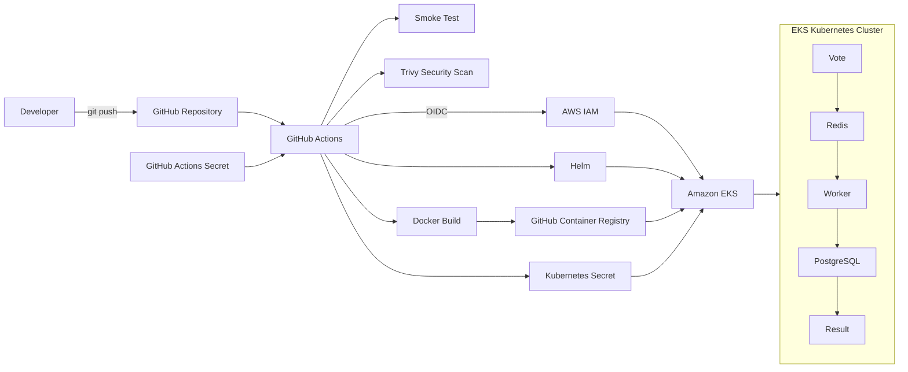

# DevOps Capstone 1 — Example Voting App

This repository contains my DevOps implementation of the Docker Example Voting App.

The project demonstrates an end-to-end container delivery workflow using Docker, Terraform, Amazon EKS, Helm, GitHub Actions, Trivy, GitHub Container Registry (GHCR), AWS IAM/OIDC, and Kubernetes Secrets.

A push to the `main` branch automatically tests the application, scans it for vulnerabilities, builds and publishes immutable container images, authenticates to AWS without long-lived AWS access keys, and deploys the exact Git commit to Kubernetes with Helm.

## Project Goals

The capstone demonstrates the ability to:

- Harden application containers.
- Provision Kubernetes infrastructure with Terraform.
- Build and scan container images automatically.
- Publish images to GitHub Container Registry.
- Deploy applications to Amazon EKS using Helm.
- Use immutable Git SHA image tags.
- Authenticate GitHub Actions to AWS using OIDC.
- Manage database credentials without committing passwords to Git.
- Verify application health after deployment.
- Perform a live Helm rollback.

## Application

The application consists of five components:

| Component | Technology | Purpose |
| --- | --- | --- |
| `vote` | Python | Web interface used to submit votes |
| `redis` | Redis | Queue used to receive votes |
| `worker` | .NET | Processes votes from Redis and writes them to PostgreSQL |
| `db` | PostgreSQL | Stores voting data |
| `result` | Node.js | Displays voting results |

## Application Architecture

The original application architecture is shown below:


The voting flow is:

`Vote → Redis → Worker → PostgreSQL → Result`

## DevOps / Cloud Architecture



## Container Hardening

The application containers were hardened before Kubernetes deployment.

The hardening work includes:

- Pinning application base images to immutable image digests.
- Running application containers as non-root users.
- Adding `.dockerignore` files to reduce build context and prevent unnecessary files from entering images.
- Rebuilding and testing the application after the changes.
- Scanning the repository/container build workflow with Trivy.

## Running Locally

Create a local `.env` file containing:

```text
POSTGRES_PASSWORD=<your-local-password>
```

The `.env` file is ignored by Git and must not be committed.

Build and start the application:

```bash
docker compose up -d --build
```

Check the services:

```bash
docker compose ps
```

The applications are available at:

- Vote: `http://localhost:8080`
- Result: `http://localhost:8081`

Stop the environment with:

```bash
docker compose down -v
```

A smoke-test script is also provided:

```bash
./scripts/smoke-test.sh
```

If `POSTGRES_PASSWORD` is not supplied, the smoke test generates an ephemeral random password for the test environment.

## Infrastructure as Code

AWS infrastructure is defined under:

```text
terraform/
```

Terraform provisions the Amazon EKS infrastructure in `eu-west-1`, including:

- EKS cluster.
- Managed EKS node group.
- Required IAM roles and policies.
- GitHub Actions OIDC provider and deployment role.
- EKS access entry and access policy.
- Use of the AWS default VPC/subnets.
- Terraform outputs for cluster name and AWS region.

Initialize Terraform:

```bash
terraform -chdir=terraform init
```

Validate the configuration:

```bash
terraform -chdir=terraform validate
```

Review infrastructure changes:

```bash
terraform -chdir=terraform plan
```

Provision the infrastructure:

```bash
terraform -chdir=terraform apply
```

Configure `kubectl`:

```bash
aws eks update-kubeconfig \
  --region eu-west-1 \
  --name example-voting-app-cluster
```

Verify the cluster:

```bash
kubectl get nodes
```

## Helm Deployment

The Kubernetes application is packaged as a single Helm chart:

```text
helm/voting-app/
```

The chart deploys:

- Vote
- Result
- Worker
- Redis
- PostgreSQL

Validate the chart:

```bash
helm lint helm/voting-app
```

Render the manifests locally:

```bash
helm template voting-app helm/voting-app
```

Deploy manually using an immutable image tag:

```bash
helm upgrade --install voting-app helm/voting-app \
  --namespace default \
  --set image.tag=<git-commit-sha> \
  --wait \
  --timeout 5m
```

## CI/CD Pipeline

The capstone workflow is defined in:

```text
.github/workflows/capstone-ci.yml
```

For a push to `main`, the pipeline performs:

1. Application smoke testing.
2. Trivy security scanning.
3. Docker image builds for `vote`, `result`, and `worker`.
4. Pushes the images to GHCR.
5. Tags every application image with the exact Git commit SHA.
6. Authenticates to AWS using GitHub Actions OIDC.
7. Configures access to the EKS cluster.
8. Creates or updates the Kubernetes database Secret.
9. Deploys the commit to EKS using Helm.
10. Verifies the Kubernetes rollouts.

Application images are published as:

```text
ghcr.io/louiz952/example-voting-app-vote:<git-sha>
ghcr.io/louiz952/example-voting-app-result:<git-sha>
ghcr.io/louiz952/example-voting-app-worker:<git-sha>
```

This provides traceability between source code, container images, and the version running in Kubernetes.

## AWS Authentication

GitHub Actions authenticates to AWS using OpenID Connect (OIDC).

The workflow requests an OIDC identity token and assumes a dedicated AWS IAM role. Long-lived AWS access keys are therefore not stored in the GitHub repository.

The deployment role is granted access to the EKS cluster through an EKS access entry and a namespace-scoped access policy.

## Secret Management

Database credentials are not stored directly in the application source code or Helm values.

For local development:

```text
.env → Docker Compose
```

For automated deployment:

```text
GitHub Repository Secret
        ↓
GitHub Actions
        ↓
Kubernetes Secret (voting-app-db)
        ↓
PostgreSQL / Result / Worker
```

The Kubernetes workloads retrieve the password using `secretKeyRef`.

The GitHub repository secret is named:

```text
POSTGRES_PASSWORD
```

Only the secret reference is stored in the workflow; the actual value is not committed to Git.

## Rollback

Helm provides release history and rollback capability.

View release history:

```bash
helm history voting-app
```

Rollback to a previous revision:

```bash
helm rollback voting-app <revision> \
  --wait \
  --timeout 5m
```

As part of this capstone, a deliberately invalid application image tag was deployed to demonstrate a failed rollout scenario. The release was then successfully rolled back to the previous healthy revision and the application returned to a working state.

## Verification

Useful commands for validating a deployment include:

```bash
kubectl get nodes
kubectl get pods
kubectl get services
helm status voting-app
helm history voting-app
```

Check the exact images running in EKS:

```bash
kubectl get deployments vote result worker \
  -o custom-columns='NAME:.metadata.name,IMAGE:.spec.template.spec.containers[0].image'
```

The deployed image tags should correspond to the Git SHA used by the successful GitHub Actions run.

## Security Controls

This project includes several security controls:

- Non-root application containers.
- Pinned application base-image digests.
- Trivy scanning in CI.
- GitHub Actions OIDC authentication to AWS.
- No long-lived AWS credentials stored in the repository.
- GitHub repository secrets for CI/CD credentials.
- Kubernetes Secrets for runtime database credentials.
- `.env` excluded from Git.
- Environment-based credentials for local Compose configurations.
- Immutable Git SHA tags for application images.
- Namespace-scoped EKS deployment access for GitHub Actions.

## Repository Structure

```text
.
├── .github/workflows/       # CI/CD workflows
├── helm/voting-app/         # Helm chart
├── terraform/               # AWS/EKS infrastructure
├── scripts/                 # Smoke testing
├── vote/                    # Python voting service
├── result/                  # Node.js result service
├── worker/                  # .NET worker
├── healthchecks/            # Container health checks
├── k8s-specifications/      # Original Kubernetes manifests
├── docker-compose.yml       # Local development stack
└── architecture.excalidraw.png
```

## Infrastructure Cleanup

AWS resources created by this project are billable.

When the capstone demonstration is complete, uninstall the Helm release first:

```bash
helm uninstall voting-app
```

Confirm that Kubernetes resources and AWS load balancers created for the application have been removed before destroying the infrastructure.

Then destroy the Terraform-managed infrastructure:

```bash
terraform -chdir=terraform destroy
```

Review the Terraform destroy plan carefully before confirming it.

## Capstone Outcome

The completed delivery path is:

```text
Code
  ↓
GitHub
  ↓
GitHub Actions
  ├── Smoke Test
  ├── Trivy Scan
  ├── Docker Build
  └── GHCR Push
  ↓
AWS OIDC Authentication
  ↓
Helm
  ↓
Amazon EKS
  ↓
Live Voting Application
```

The project demonstrates a reproducible DevOps workflow in which a source-code push can build, scan, publish, and deploy an immutable application version to Kubernetes without committing application secrets or long-lived AWS credentials.

## Credits

The application is based on Docker's Example Voting App. This repository extends the sample application with container hardening, Terraform-managed AWS infrastructure, Helm packaging, security controls, and an automated CI/CD deployment pipeline for the DevOps capstone.